# 개발 워크스테이션 구축

Windows의 WSL 2 Ubuntu에서 리눅스 CLI와 파일 권한을 실습했다. Docker Desktop으로 NGINX 웹 서버를 빌드하고, 포트 매핑과 두 가지 스토리지 연결 방식의 동작을 확인했다.

## 실행 환경

| 항목 | 환경 |
| --- | --- |
| 호스트 및 터미널 | Windows, Windows PowerShell 5.1 |
| 실습 환경 | WSL 2, Ubuntu 26.04.1 LTS, GNU Bash 5.3.9(1) |
| Docker | Docker Desktop WSL 2 백엔드, Docker CLI 및 Linux 엔진 29.9.3 |
| Git | Ubuntu Git 2.53.0 |

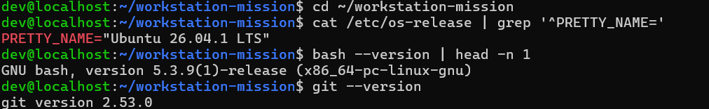

## 웹 서버 재현

Docker 엔진이 실행 중인지 `docker info`로 확인한 뒤, 저장소의 최상위 폴더에서 아래 명령을 실행한다. `8080`을 다른 프로세스가 사용 중이면 호스트 포트 `8080`과 접속 주소의 포트를 비어 있는 번호로 함께 바꾼다.

```bash
docker build -t workstation-web:1.0 .
docker run -d --name workstation-demo -p 127.0.0.1:8080:80 workstation-web:1.0
curl -fsS http://127.0.0.1:8080
```

```html
<h1>My Docker Workstation</h1>
```

[Dockerfile](Dockerfile)은 `nginx:alpine`을 기반으로 [직접 작성한 HTML](site/index.html)을 NGINX 문서 경로에 복사한다. 이미지에 파일을 포함하면 같은 이미지에서 실행한 컨테이너가 같은 페이지를 제공한다. 포트 매핑은 호스트에서 컨테이너의 웹 서버에 접속할 경로를 만든다.

| 파일 또는 경로 | 역할과 설계 기준 |
| --- | --- |
| `Dockerfile` | NGINX 베이스 이미지에서 웹 서버 실행 환경을 가져오고, 프로젝트에서 배포할 콘텐츠만 `COPY`로 지정한다. |
| `site/index.html` | 이미지에 들어가는 웹 소스다. 페이지 제목으로 커스텀 콘텐츠가 제공되는지 확인한다. |
| `evidence/` | 원본 캡처와 실습 기록을 보관한다. 배포할 파일은 `site/`에 두고 Dockerfile에서 그 경로만 복사한다. |

이미지는 파일과 실행 설정을 담은 빌드 결과물이고, 컨테이너는 그 이미지에서 실행되는 인스턴스다. 예를 들어 제목을 바꾸면 `site/index.html`을 저장하고 `docker build -t workstation-web:1.1 .`로 다시 빌드한다. `docker stop workstation-demo`와 `docker rm workstation-demo`로 기존 실습 컨테이너를 정리하고, 위 `docker run` 명령에서 `1.1` 태그로 새 컨테이너를 실행한다. 기존 컨테이너는 새 이미지를 빌드해도 자동으로 바뀌지 않는다.

### 포트 충돌 확인과 해결

```bash
docker ps --format '{{.Names}}\t{{.Ports}}'
ss -ltnp 'sport = :8080'
```

`docker ps`로 `8080`을 공개한 Docker 컨테이너를 찾고, `ss`로 현재 Linux 네트워크 환경에서 그 포트를 수신 중인 소켓을 확인한다. 점유자가 본인이 만든 테스트 컨테이너면 `docker stop <컨테이너_이름>`으로 포트를 해제한다. WSL에서 찾을 수 없으면 Windows PowerShell의 `Get-NetTCPConnection -LocalPort 8080 -State Listen`에서 `OwningProcess`를 확인하고 `Get-Process -Id <PID>`로 앱을 확인한다. 해당 앱을 정상 종료해 포트를 비우거나 비어 있는 다른 호스트 포트를 실행 명령과 접속 주소에 사용한다.

## 수행 체크리스트와 검증 결과

- [x] [터미널 기본 조작](#터미널-파일-및-디렉터리-조작)과 [권한 변경](#파일과-디렉터리-권한-변경)
- [x] [Docker 설치와 엔진 점검, hello-world 실행](#docker-설치와-동작-확인)
- [x] [Ubuntu 컨테이너 내부 접속](#ubuntu-컨테이너-실행과-내부-접속)과 [운영 명령](#docker-로그와-자원-사용량-중지-상태-확인)
- [x] [Dockerfile 빌드](#nginx-커스텀-이미지-빌드)와 [포트 매핑·브라우저 접속](#웹-컨테이너-실행과-포트-매핑)
- [x] [바인드 마운트 변경 반영](#바인드-마운트-변경-반영)
- [x] [볼륨 영속성](#docker-볼륨-영속성-확인)
- [x] [Git 초기화](#git-저장소-초기화)와 [작성자 설정](#git-커밋-작성자-설정)
- [x] [VS Code에서 WSL 과제 폴더 열기](#vs-code에서-wsl-과제-폴더-열기)
- [x] [VS Code에서 GitHub 로그인 확인](#vs-code에서-wsl-과제-폴더-열기)
- [x] [GitHub 원격 저장소 연동](#github-원격-저장소-게시)

[실습 기록](evidence/README.md)에 명령별 목적, 실제 출력과 캡처, [트러블슈팅](#트러블슈팅)을 정리했다.

## WSL과 Ubuntu 설치

```powershell
wsl --install -d Ubuntu
```

Windows에서 리눅스 CLI를 사용하기 위해 WSL과 Ubuntu 배포판을 설치했다. 첫 실행에서는 WSL `3.0.5`와 가상 머신 플랫폼 기능이 설치됐고, 적용하려면 Windows를 다시 시작하라는 메시지가 나왔다. 재부팅 후 Ubuntu 배포판이 등록되지 않은 것을 확인해 같은 명령을 다시 실행했다. 두 번째 실행에서는 Ubuntu 설치가 완료되고 초기 계정 설정 화면이 열렸다.

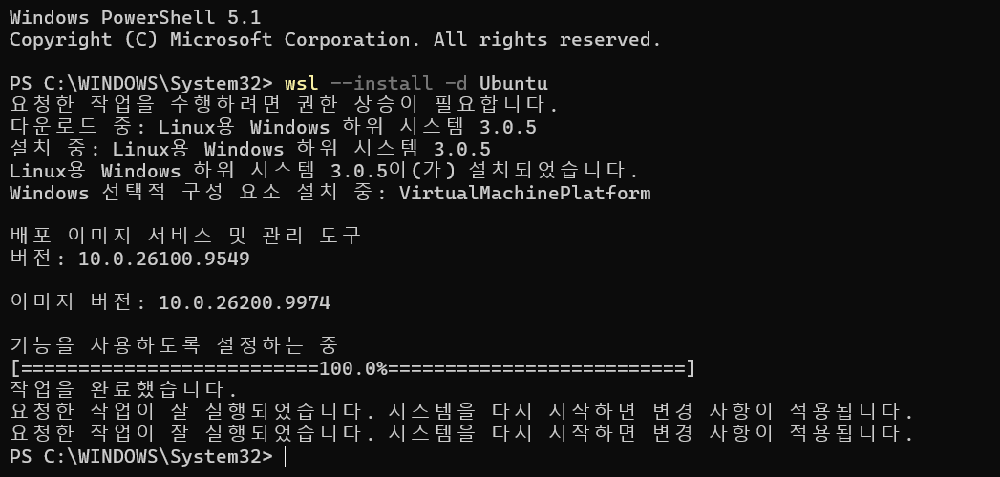

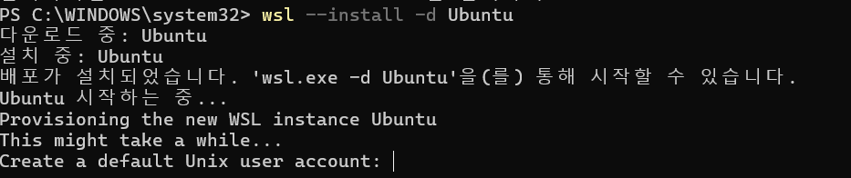

```powershell
wsl -l -v
```

등록된 배포판과 각 배포판의 WSL 모드를 확인했다. `-l`은 배포판을 나열하고, `-v`는 상태와 버전 열을 함께 표시한다. Docker Desktop과 연동할 Ubuntu의 `VERSION`이 `2`인지 이 명령으로 확인했다.

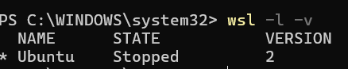

```text
  NAME      STATE     VERSION
* Ubuntu    Stopped   2
```

## Docker 설치와 동작 확인

Docker Desktop은 현재 Windows 사용자용으로 설치하고 WSL 2를 선택했다. WSL Integration에서 기본 배포판 연동을 켜 Ubuntu 터미널에서 Docker 엔진을 사용할 수 있게 했다.

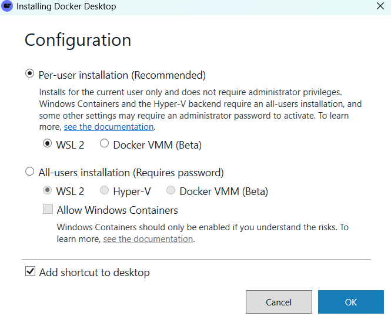

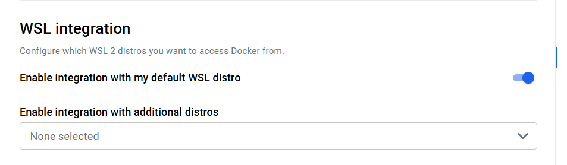

```powershell
wsl -d Ubuntu
```

PowerShell에서 Ubuntu의 Bash로 들어가 Docker 명령이 Ubuntu 환경에서 실행되는지 확인하기 위해 사용했다.

```bash
docker --version
```

Ubuntu에서 Docker CLI가 실행되는지 확인하고 클라이언트 버전을 기록했다. 엔진 연결은 이어지는 `docker info`로 확인했다.

```text
Docker version 29.9.3, build 5457199
```

```bash
docker info --format 'Server={{.ServerVersion}} OS={{.OSType}}'
```

Docker CLI가 엔진에 연결되어 서버 정보를 읽을 수 있는지 확인했다. 기본 `docker info` 출력이 길어 `--format`으로 서버 버전과 엔진의 OS 유형만 한 줄로 표시했다.

```text
Server=29.9.3 OS=linux
```

```console
$ docker info --format 'ServerVersion={{.ServerVersion}} OSType={{.OSType}} OperatingSystem={{.OperatingSystem}}'
ServerVersion=29.9.3 OSType=linux OperatingSystem=Docker Desktop
```

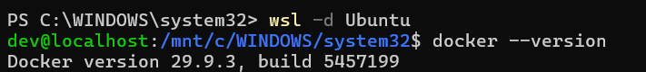

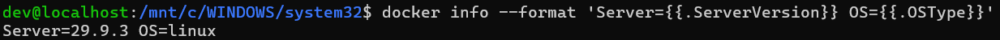

```bash
docker run --rm hello-world
```

테스트 이미지로 컨테이너를 실제 실행해 출력이 터미널에 돌아오는지 확인했다. `--rm`은 테스트 컨테이너가 종료되면 자동으로 삭제한다.

```text
Hello from Docker!
```

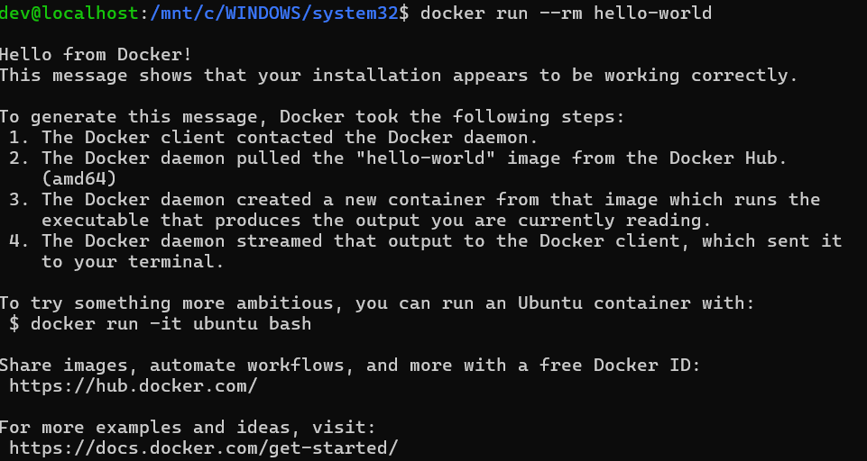

## Ubuntu 컨테이너 실행과 내부 접속

```bash
docker pull ubuntu
docker images
docker run -dit --name mission-ubuntu ubuntu bash
docker exec -it mission-ubuntu bash
```

`docker pull`로 `ubuntu:latest` 이미지를 내려받고, `docker images`로 로컬 이미지 목록에서 `ubuntu:latest`와 `hello-world:latest`를 확인했다. `docker run`은 그 이미지에서 `mission-ubuntu` 컨테이너를 만들고 Bash를 주 프로세스로 실행했다. `-d`로 백그라운드에서 실행하고, `-i`로 표준 입력을 열어 두고, `-t`로 가상 터미널을 할당했다. `docker exec -it`로 실행 중인 컨테이너에 별도의 대화형 Bash 셸을 열었다.

컨테이너 안에서 `ls`로 루트 디렉터리의 내용을 확인했다. `echo`로 문자열을 출력해 명령이 내부에서 실행되는지 확인한 뒤 `exit`로 이 셸을 종료했다.

```bash
ls
echo "Hello from the Ubuntu container"
exit
```

```text
Hello from the Ubuntu container
```

호스트 Ubuntu로 돌아와 `docker ps`로 실행 중인 컨테이너를 확인했다. `mission-ubuntu`가 `Up 46 seconds`로 표시됐다. `exec`로 연 별도 셸이 종료된 뒤에도 처음 실행한 Bash가 계속 동작했다.

## Docker 로그와 자원 사용량, 중지 상태 확인

```text
docker images 출력 발췌
IMAGE                ID             DISK USAGE   CONTENT SIZE
hello-world:latest   1e4c05b897a7   25.9kB       9.49kB
ubuntu:latest        d66b366dac61   163MB        45.9MB
```

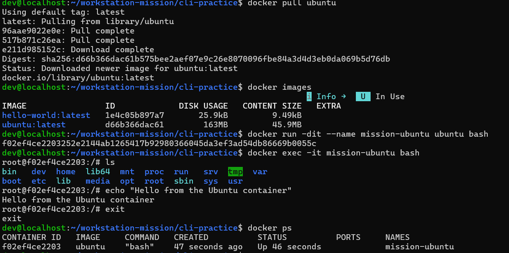

Ubuntu에서 `docker attach mission-ubuntu`를 실행해 컨테이너의 주 프로세스인 Bash에 연결했다. 앞서 사용한 `docker exec`는 새 Bash를 열었고, `attach`는 이미 실행 중인 Bash에 연결했다. 그 셸에서 `echo "Attached to the main shell"`을 실행했다. `Ctrl+P` 다음 `Ctrl+Q`를 눌러 컨테이너를 실행 상태로 둔 채 호스트 Ubuntu로 돌아왔다.

```bash
docker logs --tail 10 mission-ubuntu
docker stats --no-stream mission-ubuntu
docker stop mission-ubuntu
docker ps -a
```

- `docker logs --tail 10`으로 컨테이너 로그의 마지막 열 줄을 요청했다. 주 Bash에서 출력한 `Attached to the main shell`이 로그에 남은 것을 확인했다.
- `docker stats --no-stream`으로 실행 중인 컨테이너의 CPU, 메모리, 네트워크와 디스크 I/O를 한 번 조회했다. 조회 시점에 CPU는 `0.00%`, 메모리 사용량은 `2.043 MiB`였다.
- `docker stop`으로 컨테이너를 중지했다. `docker ps -a`는 중지된 컨테이너도 표시하므로, `mission-ubuntu`가 목록에 남고 상태가 `Exited (137)`로 바뀐 것을 확인할 수 있었다.

```text
docker logs   Attached to the main shell
docker stats  CPU 0.00%, 메모리 2.043 MiB / 7.677 GiB
docker ps -a  mission-ubuntu, Exited (137)
```

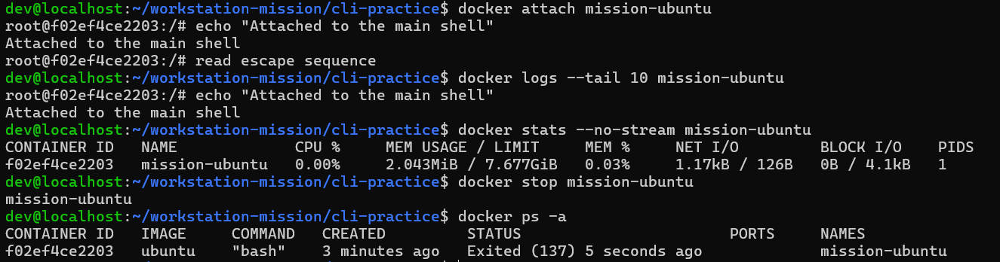

## 터미널 파일 및 디렉터리 조작

### 파일 생성 → 이동 → 삭제 연속 실행 기록

Ubuntu의 임시 실습 디렉터리에서 파일 생성부터 삭제 확인까지 한 번에 실행했다. `touch`로 빈 파일을 만들고 `printf`로 텍스트 파일을 만든 뒤 `ls -la`와 `cat`으로 확인했다. 복사본을 `mv`로 하위 폴더로 옮기면서 이름을 변경하고, `rm` 전후에 `ls`와 `cat`을 실행했다. 마지막 `cat`에서 삭제한 파일은 `No such file or directory` 오류가 나고 원본은 같은 내용을 출력했다. 이 실행의 stdout과 stderr를 아래에 순서대로 함께 기록했다. [원본 터미널 로그](evidence/31-cli-create-move-delete.txt)

```console
$ pwd
/tmp/workstation-cli-check.WYVdsY
$ mkdir moved
$ touch .empty
$ printf '%s\n' 'CLI practice' > original.txt
$ ls -la
total 4
drwx------ 3 dev  dev  100 Nov 25 01:04 .
drwxrwxrwt 7 root root 160 Nov 25 01:04 ..
-rw-r--r-- 1 dev  dev    0 Nov 25 01:04 .empty
drwxr-xr-x 2 dev  dev   40 Nov 25 01:04 moved
-rw-r--r-- 1 dev  dev   13 Nov 25 01:04 original.txt
$ cat original.txt
CLI practice
$ cp original.txt copy.txt
$ mv copy.txt moved/renamed.txt
$ ls -la
total 4
drwx------ 3 dev  dev  100 Nov 25 01:04 .
drwxrwxrwt 7 root root 160 Nov 25 01:04 ..
-rw-r--r-- 1 dev  dev    0 Nov 25 01:04 .empty
drwxr-xr-x 2 dev  dev   60 Nov 25 01:04 moved
-rw-r--r-- 1 dev  dev   13 Nov 25 01:04 original.txt
$ ls -l moved
total 4
-rw-r--r-- 1 dev dev 13 Nov 25 01:04 renamed.txt
$ cat moved/renamed.txt
CLI practice
$ rm moved/renamed.txt
$ ls -la moved
total 0
drwxr-xr-x 2 dev dev  40 Nov 25 01:04 .
drwx------ 3 dev dev 100 Nov 25 01:04 ..
$ cat moved/renamed.txt
cat: moved/renamed.txt: No such file or directory
$ cat original.txt
CLI practice
```


Ubuntu 홈 디렉터리 안에 실습 폴더를 만들고, 파일을 생성·확인·복사·이름 변경·삭제했다.

```bash
cd ~
mkdir -p ~/workstation-mission/cli-practice
cd ~/workstation-mission/cli-practice
pwd
printf 'CLI practice\n' > original.txt
touch .hidden
cat original.txt
cp original.txt copy.txt
mv copy.txt renamed.txt
ls -la
rm renamed.txt
ls -la
```

- `cd ~`로 Ubuntu 홈으로 이동했다. `mkdir -p`로 실습 폴더와 필요한 상위 폴더를 만들고 `cd`로 들어갔다. `pwd`로 `/home/dev/workstation-mission/cli-practice`라는 절대 경로를 확인했다.
- `printf`와 `>`로 실습 문구를 `original.txt`에 기록했다. `touch .hidden`으로 빈 숨김 파일을 만들었고, `cat original.txt`로 파일 내용 `CLI practice`를 확인했다. `original.txt`는 현재 디렉터리를 기준으로 해석되는 상대 경로다.
- `cp`로 원본의 복사본을 만들고 `mv`로 복사본 이름을 `renamed.txt`로 바꿨다. `ls -la`에서 `-l`은 권한과 크기 등 상세 정보를, `-a`는 `.hidden`을 포함한 숨김 항목을 표시한다.
- `rm renamed.txt`로 이름을 바꾼 복사본을 삭제했다. 두 번째 `ls -la`에서 `.hidden`과 `original.txt`는 남아 있고 `renamed.txt`가 사라진 것을 확인했다.

절대 경로 `/home/dev/workstation-mission/cli-practice`는 `/`에서 시작하므로 현재 위치와 관계없이 같은 디렉터리를 지정한다. `original.txt`와 `site/index.html` 같은 상대 경로는 현재 작업 디렉터리를 기준으로 해석되므로 `pwd`로 위치를 확인한 뒤 사용한다. `~/workstation-mission`으로 이동하면 셸이 `~`를 현재 사용자의 홈 절대 경로로 확장하므로 사용자 이름에 관계없이 같은 절차를 재현할 수 있다.

```text
pwd
/home/dev/workstation-mission/cli-practice

cat original.txt
CLI practice

ls -la (삭제 전, 발췌)
-rw-r--r-- 1 dev dev  0 Nov 24 23:51 .hidden
-rw-r--r-- 1 dev dev 13 Nov 24 23:51 original.txt
-rw-r--r-- 1 dev dev 13 Nov 24 23:51 renamed.txt

ls -la (삭제 후, 발췌)
-rw-r--r-- 1 dev dev  0 Nov 24 23:51 .hidden
-rw-r--r-- 1 dev dev 13 Nov 24 23:51 original.txt
```

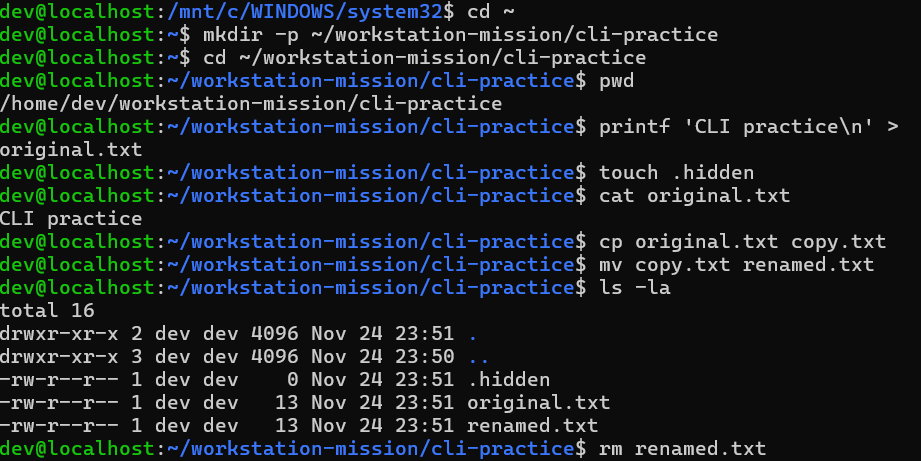

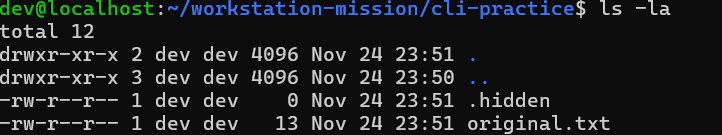

## 파일과 디렉터리 권한 변경

`mkdir -p`로 권한을 비교할 디렉터리를 만들었다. `chmod`로 파일과 디렉터리를 각각 `600`, `700`으로 설정해 비교 기준을 만들고, 이후 `644`, `755`로 바꿨다. `ls -ld`에서 `-l`은 권한을 포함한 상세 정보를 표시하고, `-d`는 디렉터리의 내용 대신 디렉터리 자체를 표시한다.

```bash
mkdir -p sample-dir
chmod 600 original.txt
chmod 700 sample-dir
ls -ld original.txt sample-dir
chmod 644 original.txt
chmod 755 sample-dir
ls -ld original.txt sample-dir
```

```text
변경 전
-rw------- 1 dev dev   13 Nov 24 23:51 original.txt
drwx------ 2 dev dev 4096 Nov 24 23:53 sample-dir

변경 후
-rw-r--r-- 1 dev dev   13 Nov 24 23:51 original.txt
drwxr-xr-x 2 dev dev 4096 Nov 24 23:53 sample-dir
```

권한 숫자 세 자리는 소유자, 그룹, 그 외 사용자 순서다. 각 자리는 읽기 `r=4`, 쓰기 `w=2`, 실행 또는 디렉터리 통과 `x=1`을 합산한다. 파일의 `600 → 644` 변경은 그룹과 그 외 사용자에게 읽기 권한을 추가했다. 디렉터리의 `700 → 755` 변경은 그룹과 그 외 사용자에게 목록을 읽고 경로를 통과할 권한을 추가했다.

| 권한 | 숫자 | 파일 | 디렉터리 |
| --- | --- | --- | --- |
| `r` | 4 | 내용을 읽는다. | 항목 이름을 나열한다. |
| `w` | 2 | 내용을 수정한다. | 통과 권한과 함께 항목을 생성·삭제·이름 변경한다. |
| `x` | 1 | 실행한다. | 디렉터리에 들어가거나 경로를 따라 항목에 접근한다. |

`644 = rw-r--r--`는 `6=4+2`, `4`, `4`다. `755 = rwxr-xr-x`는 `7=4+2+1`, `5=4+1`, `5=4+1`이다. 실습을 마친 파일과 폴더를 저장소 최상위에서 각각 다시 확인했다.

```console
$ ls -l cli-practice/original.txt
-rw-r--r-- 1 dev dev 13 Nov 24 23:51 cli-practice/original.txt
$ ls -ld cli-practice/sample-dir
drwxr-xr-x 2 dev dev 4096 Nov 24 23:53 cli-practice/sample-dir
```

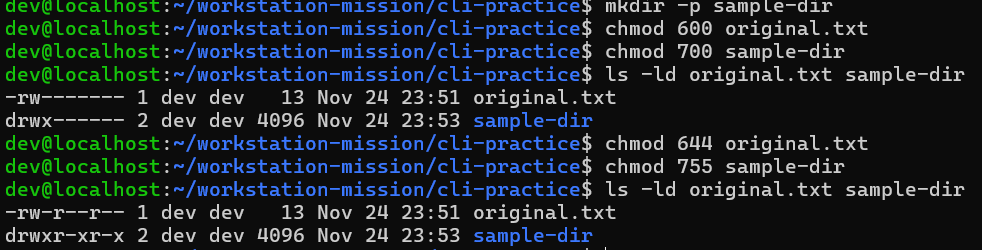

## NGINX 커스텀 이미지 빌드

```bash
cd ~/workstation-mission
mkdir -p site
printf '%s\n' '<h1>My Docker Workstation</h1>' > site/index.html
echo 'FROM nginx:alpine' > Dockerfile
echo 'COPY site/ /usr/share/nginx/html/' >> Dockerfile
cat Dockerfile
docker build -t workstation-web:1.0 .
```

- `mkdir -p site`로 웹 콘텐츠 폴더를 만들고, `printf`의 출력을 `site/index.html`에 저장했다. 브라우저에서 커스텀 페이지가 제공되는지 제목으로 확인할 수 있도록 했다.
- `FROM nginx:alpine`으로 기존 NGINX 실행 환경을 사용했다. `COPY`는 직접 만든 정적 파일을 NGINX의 기본 문서 경로 `/usr/share/nginx/html/`에 넣는다. `>`로 Dockerfile의 첫 줄을 저장하고 `>>`로 두 번째 줄을 추가한 뒤, `cat`으로 두 줄을 확인했다.

  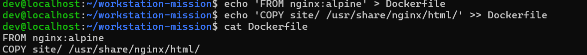
- `docker build`에서 `-t workstation-web:1.0`으로 이미지 이름과 태그를 지정했다. 마지막 `.`은 현재 폴더를 빌드 컨텍스트로 사용한다는 뜻이다. 빌드 로그에서 `COPY` 단계와 이미지 내보내기가 완료된 것을 확인했다.

```text
[+] Building 7.5s (7/7) FINISHED
=> [2/2] COPY site/ /usr/share/nginx/html/
=> => naming to docker.io/library/workstation-web:1.0
```

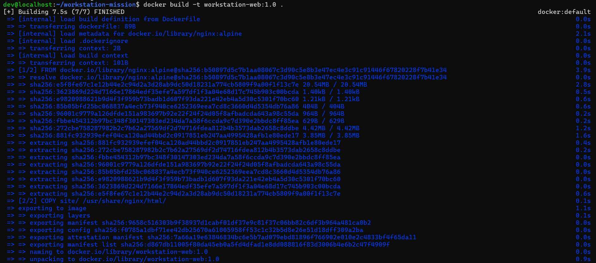

## 웹 컨테이너 실행과 포트 매핑

```bash
docker run -d --name web-8080 -p 127.0.0.1:8080:80 workstation-web:1.0
docker run -d --name web-8081 -p 127.0.0.1:8081:80 workstation-web:1.0
docker ps
```

같은 이미지로 컨테이너 두 개를 백그라운드에서 실행했다. `-p`는 호스트의 포트를 컨테이너 내부의 NGINX 포트 `80`에 연결한다. 두 컨테이너가 각각 격리되어 내부 포트 `80`을 사용할 수 있고, 호스트에서는 `8080`과 `8081`을 통해 각각 접근할 수 있다. `127.0.0.1`을 지정해 호스트의 로컬 주소에만 포트를 열었다. `docker ps`로 두 컨테이너가 `Up` 상태이고 포트가 예상대로 매핑됐는지 확인했다.

```text
web-8080  Up 9 seconds  127.0.0.1:8080->80/tcp
web-8081  Up 3 seconds  127.0.0.1:8081->80/tcp
```

Linux 컨테이너는 기본적으로 별도의 **네트워크 네임스페이스**에서 자기 인터페이스와 리스닝 포트를 사용한다. `-p 127.0.0.1:8080:80`은 호스트의 루프백 주소 `127.0.0.1`과 포트 `8080`에 들어온 연결을 해당 컨테이너의 네임스페이스 안에 있는 `80/tcp`로 전달한다.

Windows 브라우저에서 `http://127.0.0.1:8080`과 `http://127.0.0.1:8081`을 각각 열었다. 두 주소 모두에서 `My Docker Workstation` 제목이 표시되어 이미지에 넣은 `index.html`이 제공되는 것을 확인했다.

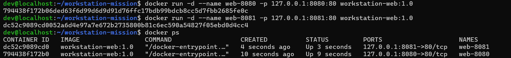

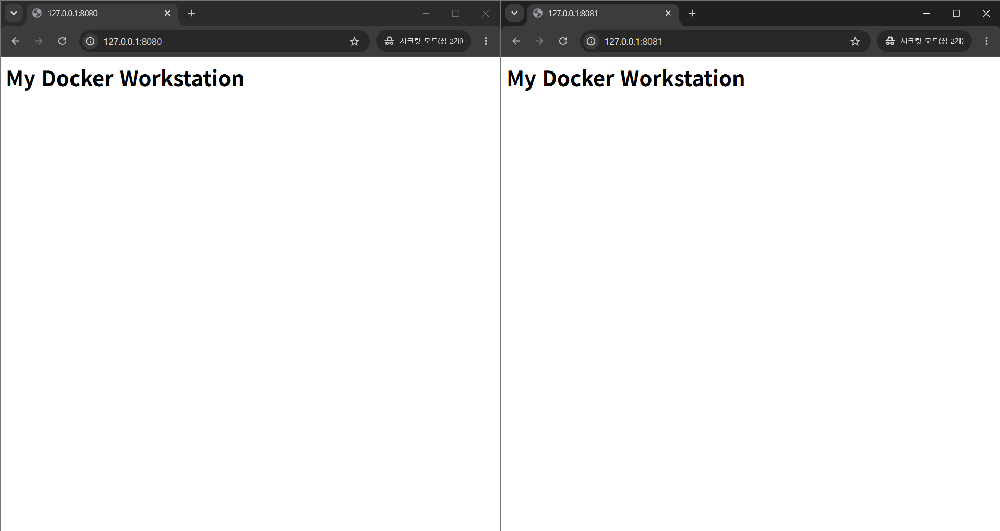

## 바인드 마운트 변경 반영

```bash
cd ~/workstation-mission
mkdir -p bind-site
cp site/index.html bind-site/index.html
docker run -d --name web-bind -p 127.0.0.1:8082:80 --mount "type=bind,source=$PWD/bind-site,target=/usr/share/nginx/html,readonly" workstation-web:1.0
curl -fsS http://127.0.0.1:8082
echo '<h1>Bind mount updated</h1>' > bind-site/index.html
curl -fsS http://127.0.0.1:8082
```

`mkdir`와 `cp`로 실습용 웹 콘텐츠를 마련했다. `--mount type=bind`는 현재 디렉터리(`$PWD`)의 `bind-site`를 컨테이너의 NGINX 문서 경로에 연결했다. `readonly`는 컨테이너에서 해당 경로에 쓰는 것을 막는다. Ubuntu 호스트에서는 `echo`와 `>`로 `index.html`을 수정할 수 있었다. 같은 URL에 `curl`을 두 번 실행해 수정 전후 응답을 비교했다. `-f`는 HTTP 오류 응답을 실패로 처리하고, `-sS`는 진행 표시를 숨기면서 오류 메시지는 보여 준다.

```text
변경 전 <h1>My Docker Workstation</h1>
변경 후 <h1>Bind mount updated</h1>
```

이미지를 다시 빌드하거나 컨테이너를 재시작하는 과정 없이, 호스트에서 바꾼 HTML이 실행 중인 웹 서버 응답에 반영됐다.

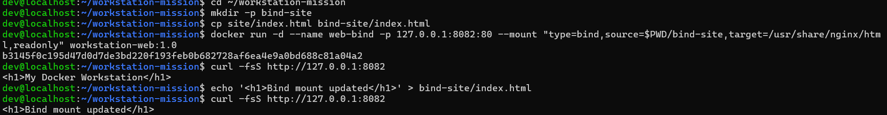

## Docker 볼륨 영속성 확인

```bash
docker volume create mission-data
docker run -d --name volume-first -v mission-data:/data ubuntu sleep infinity
docker exec volume-first sh -c 'echo "Volume data survived" > /data/message.txt'
docker exec volume-first cat /data/message.txt
docker stop volume-first
docker rm volume-first
docker run -d --name volume-second -v mission-data:/data ubuntu sleep infinity
docker exec volume-second cat /data/message.txt
```

- `docker volume create`로 Docker가 관리하는 이름 있는 볼륨 `mission-data`를 생성했다. `-v mission-data:/data`로 같은 볼륨을 두 컨테이너의 `/data` 경로에 연결했다. `sleep infinity`로 각 컨테이너를 검증 명령을 실행하는 동안 유지했다.
- `docker exec ... sh -c`로 리디렉션을 컨테이너 내부 셸에서 처리해 `/data/message.txt`에 데이터를 썼다. `cat`으로 첫 번째 컨테이너에서 파일 내용을 확인했다.
- `docker stop`으로 첫 컨테이너를 중지하고 `docker rm`으로 삭제했다. 새 컨테이너에 같은 볼륨을 연결한 뒤 파일에 다시 쓰는 과정 없이 `cat`으로 동일한 내용을 읽었다. 파일이 컨테이너의 수명과 별개로 유지됨을 확인했다.

```text
volume-first에서 삭제 전  Volume data survived
docker rm 출력           volume-first
volume-second에서 생성 후 Volume data survived
```

추가로 볼륨의 드라이버와 새 컨테이너의 파일 목록을 확인했다.

```console
$ docker volume inspect --format '{{.Name}} ({{.Driver}})' mission-data
mission-data (local)
$ docker exec volume-second ls -l /data/message.txt
-rw-r--r-- 1 root root 21 Nov 24 15:09 /data/message.txt
$ docker exec volume-second cat /data/message.txt
Volume data survived
```

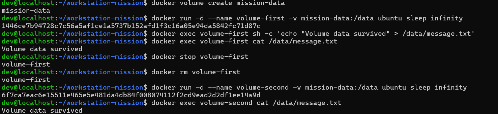

### 바인드 마운트와 볼륨 비교

| 방식 | 장점 | 제약 | 사용 사례 |
| --- | --- | --- | --- |
| 바인드 마운트 `--mount type=bind` | 호스트에서 직접 편집한 파일을 실행 중인 컨테이너에서 읽을 수 있다. | 호스트 경로와 권한에 의존한다. 쓰기가 허용된 마운트에서는 컨테이너도 호스트 파일을 수정할 수 있다. | 개발 중 HTML이나 설정 파일을 변경하고 즉시 확인할 때 |
| 이름 있는 볼륨 `-v mission-data:/data` | Docker가 저장 위치를 관리한다. 같은 볼륨을 연결하면 컨테이너를 지우고 다시 만들어도 파일을 읽을 수 있다. | 호스트 편집기로 직접 열기 어렵다. 다른 호스트로 옮길 때는 별도의 백업과 복원이 필요하다. | 데이터베이스와 같이 컨테이너를 교체해도 보존해야 할 데이터 |

## Git 저장소 초기화

```bash
git config --global init.defaultBranch main
git init
git status --short --branch
```

`git config --global init.defaultBranch main`으로 앞으로 초기화할 저장소의 기본 브랜치 이름을 설정했다. `git init`은 현재 과제 폴더에 로컬 저장소를 만들었다. `git status --short --branch`로 현재 브랜치와 추적 전 파일을 간단히 확인했다. `??`는 Git이 아직 추적하지 않는 파일 또는 폴더를 뜻한다.

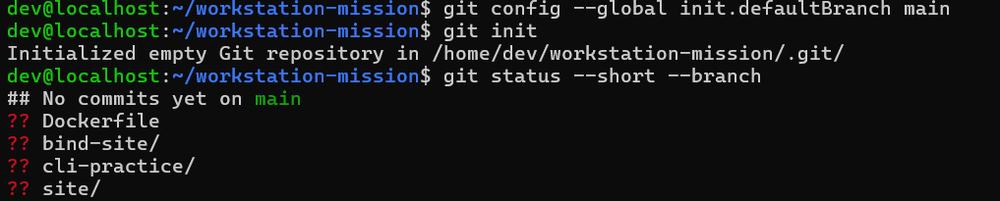

```text
## No commits yet on main
?? Dockerfile
?? bind-site/
?? cli-practice/
?? site/
```

## Git 커밋 작성자 설정

`git config --local`로 과제 저장소의 작성자 이름과 이메일을 설정했다. 이 값은 Git이 새 커밋에 기록하는 작성자 정보다. `git config --list`에서 과제에 필요한 세 항목만 `grep -E`로 골랐고, `sed`로 이메일을 가려 검증 화면에 남겼다.

```bash
git config --list | grep -E '^(init\.defaultbranch|user\.name|user\.email)=' | sed 's/^user\.email=.*/user.email=[masked]/'
```

```text
init.defaultbranch=main
user.name=daguri
user.email=[masked]
```

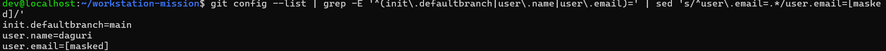

## 첫 커밋 만들기

제출용 README와 증거 파일을 과제 폴더로 복사하고, `git add`에서 제출할 파일을 직접 지정했다. `git commit -qm`으로 메시지를 지정해 조용한 모드로 커밋하고, `git log -1 --oneline`으로 가장 최근 커밋을 한 줄로 확인했다.

```bash
git add README.md Dockerfile site evidence
git commit -qm "Add workstation mission and verification evidence"
git log -1 --oneline
```

```text
0f1e96f (HEAD -> main) Add workstation mission and verification evidence
```

## VS Code에서 WSL 과제 폴더 열기

VS Code의 `WSL: Connect to WSL`로 Ubuntu에 연결하고, `File: Open Folder`에서 `/home/dev/workstation-mission`을 열었다. 왼쪽 아래의 `WSL: Ubuntu`는 VS Code가 Ubuntu 환경에 연결된 상태임을 보여 준다. 탐색기에서 `Dockerfile`과 `site`가 보여 과제 폴더를 올바르게 열었음을 확인했다.

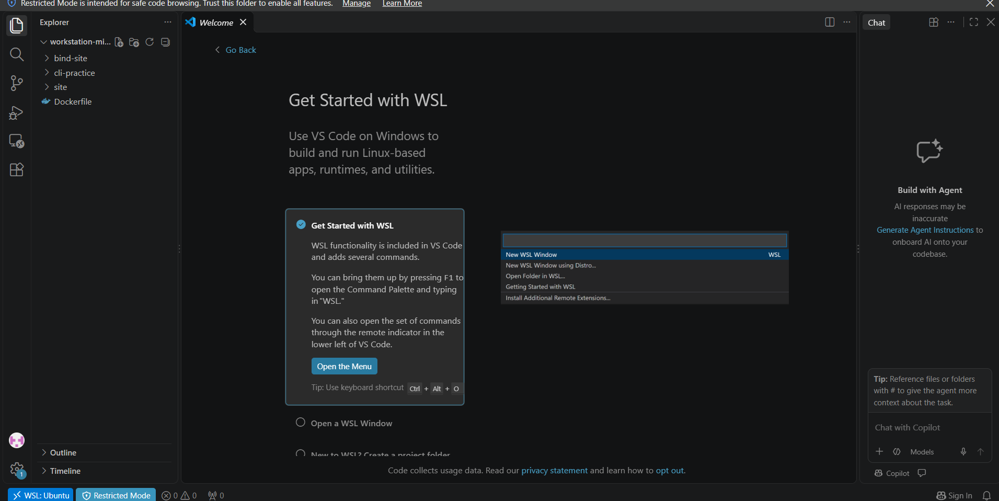

VS Code의 계정 메뉴를 열어 GitHub 계정으로 로그인되어 있는 것을 확인했다.

처음에는 `Restricted Mode`로 인해 소스 제어를 사용할 수 없었다. VS Code의 작업 영역 신뢰 설정에서 직접 만든 `/home/dev/workstation-mission` 폴더를 신뢰한 뒤, 소스 제어 화면에서 `main`과 첫 커밋을 확인했다.

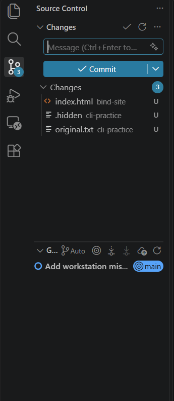

## GitHub 원격 저장소 게시

VS Code 명령 팔레트에서 `Publish to GitHub`를 실행해 `workstation-mission`을 공개 저장소로 만들고, 로컬 `main` 브랜치의 첫 커밋을 올렸다. VS Code에 게시 성공 알림이 표시됐고, GitHub 저장소의 `main`에서 `README.md`, `Dockerfile`, `site/index.html`, `evidence/README.md`를 확인했다. Git은 로컬에서 변경 이력을 기록하고, GitHub는 그 이력과 파일을 원격에서 공유할 수 있게 한다. [GitHub 저장소](https://github.com/daguri2963/workstation-mission)

`git remote -v`로 `origin`의 가져오기와 푸시 주소가 모두 과제의 GitHub 저장소인지 확인했다.

```console
$ git remote -v
origin  https://github.com/daguri2963/workstation-mission.git (fetch)
origin  https://github.com/daguri2963/workstation-mission.git (push)
```

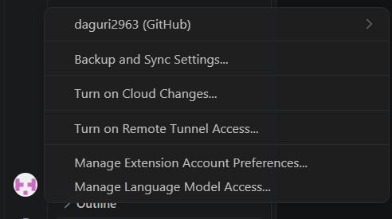

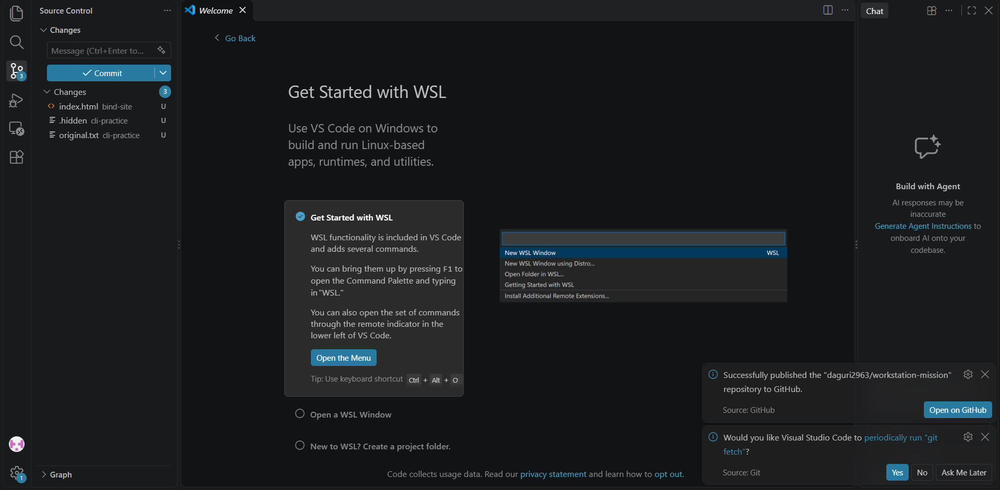

## VS Code 통합 터미널에서 푸시 확인

WSL에 연결된 VS Code에서 통합 터미널을 열었다. `git status --short --branch`로 로컬 `main`이 `origin/main`을 추적하는지 확인했고, `git push`로 원격에 보낼 커밋이 있는지 확인했다. `Everything up-to-date`는 로컬 `main`과 원격 브랜치의 커밋이 이미 일치한다는 뜻이다. `??`로 표시된 두 실습 폴더는 Git에서 추적하지 않는 파일이다.

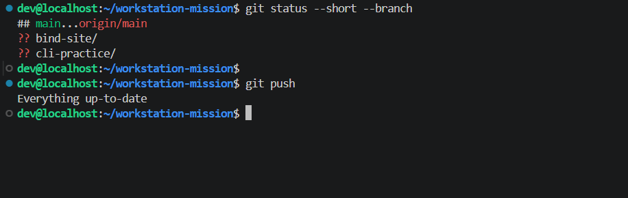

```bash
git status --short --branch
git push
```

```text
## main...origin/main
?? bind-site/
?? cli-practice/
Everything up-to-date
```

## 트러블슈팅

### WSL 설치 후 Ubuntu가 목록에 없음

- **문제** `wsl -l -v`에서 설치된 배포판이 없다고 나왔다.
- **원인 가설** 첫 설치는 WSL과 가상 머신 플랫폼을 설정했고, Ubuntu 배포판 설치는 남아 있었다.
- **확인** 최초 설치 화면에는 재부팅 안내가 나왔고, 재부팅 후 배포판 목록은 비어 있었다.
- **해결** `wsl --install -d Ubuntu`를 다시 실행해 배포판을 설치했다. `wsl -l -v`에서 Ubuntu의 `VERSION`이 `2`로 표시됐다.

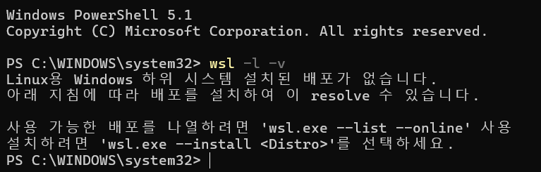

### Ubuntu 초기 계정의 비밀번호 입력 불일치

- **문제** 초기 계정 설정 중 비밀번호 변경이 실패했다.
- **원인 가설** 첫 비밀번호와 확인 입력이 달랐다.
- **확인** 터미널에 `Sorry, passwords do not match.`가 표시됐다.
- **해결** 재시도에서 같은 비밀번호를 두 번 입력했고 `passwd: password updated successfully`를 확인했다.

  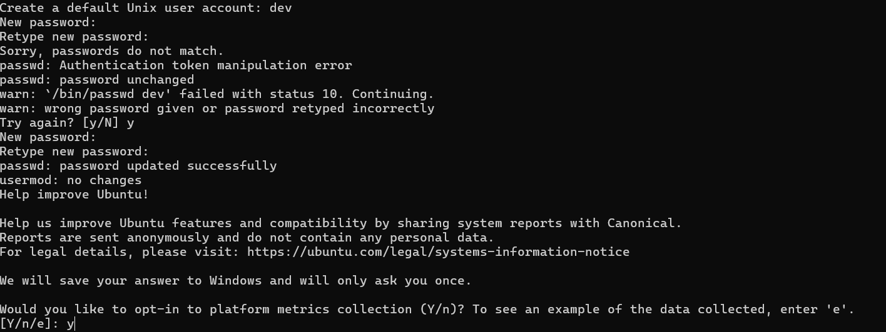

### Dockerfile 생성 명령이 줄 중간에서 실행됨

- **문제** `docker build -t workstation-web:1.0 .`가 `open Dockerfile: no such file or directory`를 출력했다.
- **원인 가설** 파일 생성 명령에서 `>` 뒤에 대상 파일 이름을 입력하기 전에 Enter를 눌러 리디렉션이 완성되지 않았다.
- **확인** Bash에서 `syntax error near unexpected token 'newline'`이 나왔고, 다음 줄의 `Dockerfile`은 별도 명령으로 처리됐다. `cat Dockerfile`로 파일이 없는 것을 확인했다.
- **해결** `echo` 명령 두 개로 나누고, 각 명령에서 `>` 또는 `>>`와 대상 파일을 같은 줄에 입력했다. `cat Dockerfile`로 두 줄을 확인한 뒤 다시 빌드해 `workstation-web:1.0` 이미지를 만들었다.

```text
-bash: syntax error near unexpected token `newline'
cat: Dockerfile: No such file or directory
ERROR: failed to build: failed to solve: failed to read dockerfile: open Dockerfile: no such file or directory
```

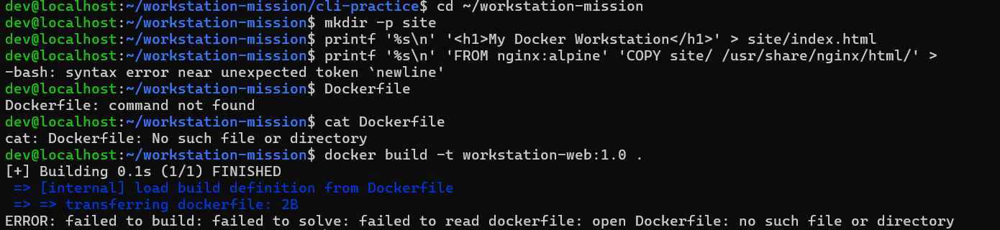
